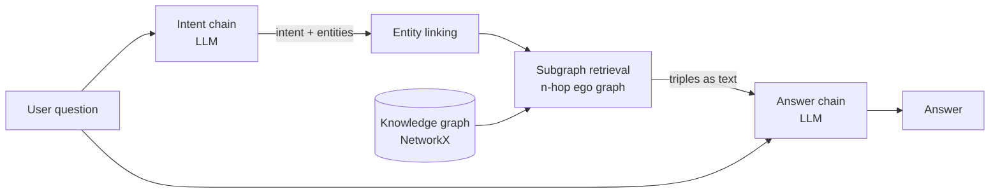

# Graph RAG — local LLM over a knowledge graph

Ask free-form questions about a graph of facts. A local Ollama model reads the question,
names the entities it cares about, and only those facts (plus their neighbours) are sent
back to the model to compose an answer.

Everything runs on your machine. No API keys, no cloud calls.

```bash
pip install langchain-ollama langchain-core networkx
ollama pull tinyllama
python graph_rag.py
```

---

## 1. Why a graph instead of a vector store

Classic RAG embeds text chunks and retrieves the ones that *look similar* to the question.
That fails on questions where the answer is a **connection** rather than a passage:

> "Who did the person who invented the Analytical Engine work with?"

No single chunk contains that. A graph answers it by walking `Analytical Engine → Babbage →
worked_with → Ada`. Retrieval is a traversal, so related facts arrive even when the question
never mentions them.

Trade-off: you need structured triples up front. Vector RAG ingests raw text for free.

---

## 2. Architecture



Two LLM calls, one graph lookup. Each stage is independently testable.

| Stage | Function | Job |
|---|---|---|
| Intent | `understand()` | Turn free text into `{intent, entities}` JSON |
| Linking | `retrieve()` — the `hits` set | Map noisy strings ("babbage") to real nodes |
| Retrieval | `retrieve()` — `nx.ego_graph` | Collect every fact within `hops` of those nodes |
| Generation | `chain`'s second prompt | Answer **only** from the retrieved triples |

### Why two calls and not one

Handing the LLM the whole graph and one prompt works on 5 facts and collapses at 5,000 —
it blows the context window and the model loses the thread. Splitting extraction from
generation keeps the second prompt small no matter how large the graph grows.

### Failure handling

A 1.1B model like tinyllama will sometimes wrap its JSON in prose. So:

- `re.search(r"\{.*\}")` digs the object out of fences or chatter.
- Any exception falls back to using the question's own words as entities. Substring
  matching then usually still finds the right nodes — degraded, never dead.
- No entity matches → `"(none)"` → the answer prompt is instructed to say the facts are
  insufficient, rather than letting the model invent one.

**Grounding rule:** the answer prompt says *use ONLY these facts*. That is what stops
hallucination. Keep it if you change the prompt.

---

## 3. Making the questions truly dynamic

The input loop already accepts any question. What limits coverage is **retrieval**, and it
scales in this order:

**Stage 1 — dynamic data (do this first).** Replace the hardcoded `FACTS` list with a load
from disk, so the graph changes without touching code:

```python
FACTS = [tuple(row) for row in json.load(open("facts.json"))]
```

Or from a CSV of `subject,relation,object`. Nothing else in the file changes.

**Stage 2 — better entity linking.** Substring matching breaks on typos and synonyms
("Lovelace, Ada"). Embed every node name once with `OllamaEmbeddings`, then match the LLM's
extracted entities by cosine similarity above a threshold. This is the single highest-value
upgrade.

**Stage 3 — use the intent.** Right now `intent` is passed to the prompt but does not shape
retrieval. Have the LLM also emit a `relations` list and filter edges by it, so "where was
Ada born" pulls `born_in` rather than all six facts.

**Stage 4 — build the graph from text.** LangChain's `LLMGraphTransformer` extracts triples
from documents automatically, so you ingest PDFs instead of writing tuples by hand.

**Stage 5 — a real graph store.** NetworkX is in-memory and dies with the process. Past
~100k edges, move to Neo4j and let the LLM emit Cypher.

---

## 4. Tuning

| Knob | Where | Effect |
|---|---|---|
| `hops` | `retrieve(entities, hops=2)` | 1 = precise, 3+ = risks dumping the whole graph |
| `model` | `ChatOllama(model=...)` | `tinyllama` is fast/weak; `llama3.1` extracts JSON far more reliably |
| `temperature` | `ChatOllama(...)` | Keep at `0` — extraction and grounded answers want determinism |

---

## 5. Known limits

- **In-memory only.** The graph is rebuilt each run; nothing persists.
- **No conversation memory.** Each question is independent — "and where was *he* born?"
  will not resolve. Add chat history to the intent prompt to fix.
- **Retrieval is unranked.** Every fact in range goes to the prompt. Fine at this size,
  needs scoring later.
- **tinyllama is the weak link,** not the graph. If answers are poor, swap the model before
  redesigning retrieval.
